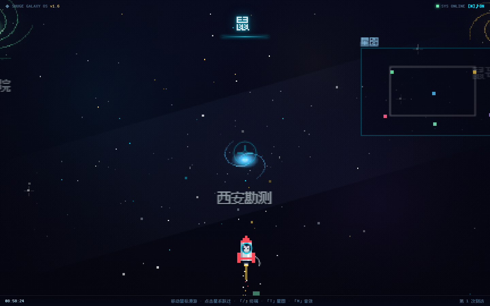
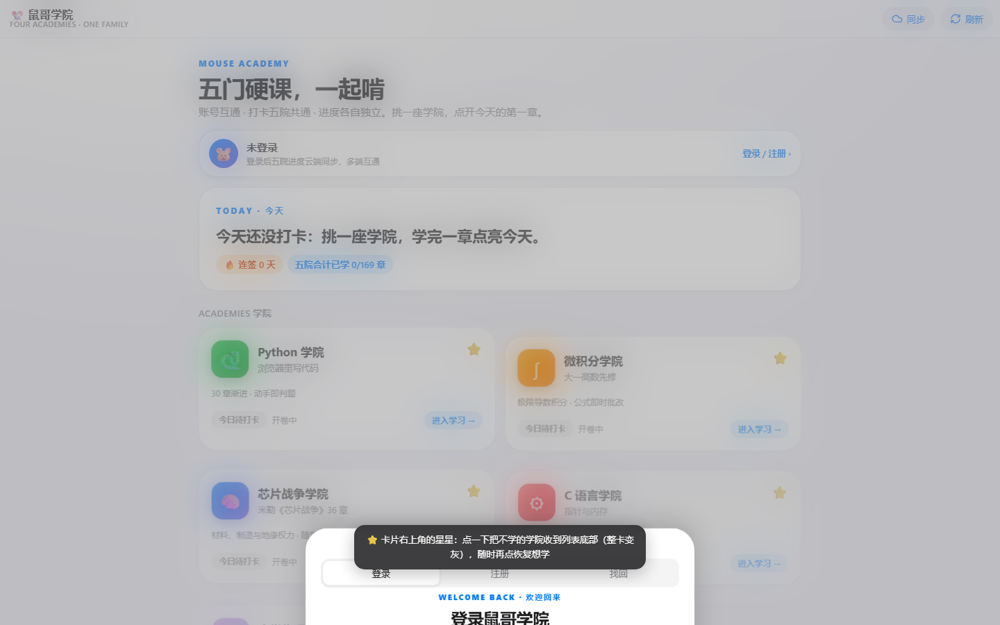
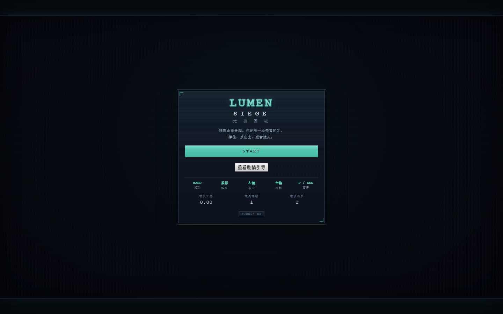

# ndshuge · SHUGE LAB

**交互式产品 · 浏览器游戏 · 学习工具 · AI 与智能系统实验**

把想法做成能打开、能操作、能探索的东西。
**Build things you can play, learn from, and question.**

[探索作品星系](https://ndshuge.github.io/ndshuge-galaxy/) · [打开游戏厅](https://ndshuge.github.io/ndshuge-game/) · [体验鼠哥学院](https://ndshuge.github.io/ndshuge-academy/) · [查看所有仓库](https://github.com/ndshuge?tab=repositories)

---

### 精选项目 / Featured work

<table>
<tr>
<td width="50%" valign="top">

**[SHUGE GALAXY · 鼠哥星系](https://ndshuge.github.io/ndshuge-galaxy/)**

个人作品的交互式入口。像素星空、项目跃迁、键盘终端与可探索的数字艺术实验。

[在线体验](https://ndshuge.github.io/ndshuge-galaxy/) · [查看源码](https://github.com/ndshuge/ndshuge-galaxy)

</td>
<td width="50%" valign="top">

**[鼠哥学院 · Interactive Academy](https://ndshuge.github.io/ndshuge-academy/)**

微积分、Python、C 语言、芯片与大学物理的互动学习门户。通过讲解、题目、代码和可操作页面探索知识。

[在线学习](https://ndshuge.github.io/ndshuge-academy/) · [查看源码](https://github.com/ndshuge/ndshuge-academy)

</td>
</tr>
<tr>
<td width="50%" valign="top">

**[LUMEN SIEGE · 光核围城](https://ndshuge.github.io/ndshuge-game/games/lumen-siege/)**

浏览器像素生存游戏，拥有怪物、升级系统和自动化测试。它是 [鼠哥游戏厅](https://ndshuge.github.io/ndshuge-game/) 15 款小游戏中的一款。

[开始游戏](https://ndshuge.github.io/ndshuge-game/games/lumen-siege/) · [查看合集](https://github.com/ndshuge/ndshuge-game)

</td>
<td width="50%" valign="top">

**[Classnote · 课堂总结](https://ndshuge.github.io/ndshuge-classnote/)**

把课程记录整理为结构化笔记。支持手动管理、导出备份，以及可选的 AI 总结与账号同步。

[打开工具](https://ndshuge.github.io/ndshuge-classnote/) · [查看源码](https://github.com/ndshuge/ndshuge-classnote)

</td>
</tr>
</table>

### 探索方向

| 方向 | 正在做什么 |
| --- | --- |
| **Playable systems** | 物理沙盒、像素生存、动作游戏和浏览器可玩的实验 |
| **Learning by building** | 把数学、编程、芯片与物理变成交互式知识体验 |
| **AI-assisted engineering** | 探索 AI 辅助工程、工具连接及可验证的开发流程 |
| **Interactive art** | 混沌、图形、声音与规则驱动的数字作品 |

### 一些开发原则

**可运行优先** — 每个项目尽量提供直接体验入口。
**解释优先** — 不仅展示结果，也希望讲清楚系统为何如此运行。
**测试优先** — 使用自动化检查，并承认它不能替代真实用户测试。
**谨慎发布** — 源代码公开不代表第三方素材、密钥或用户数据可以随意再分发。

### 更多入口

- **[游戏厅](https://ndshuge.github.io/ndshuge-game/)**：多个无需安装的浏览器游戏
- **[重力花园](https://ndshuge.github.io/gravity-garden/)**：交互式物理沙盒
- **[数学与数字艺术实验](https://ndshuge.github.io/ndshuge-galaxy/art/)**：图形、交互与可视化
- **[GitHub 仓库](https://github.com/ndshuge?tab=repositories)**：项目源码、更新记录与技术实践

页面中的截图来自项目实际网页。部分项目仍处于实验或持续迭代阶段；许可证与第三方素材授权请以各仓库文件为准。
